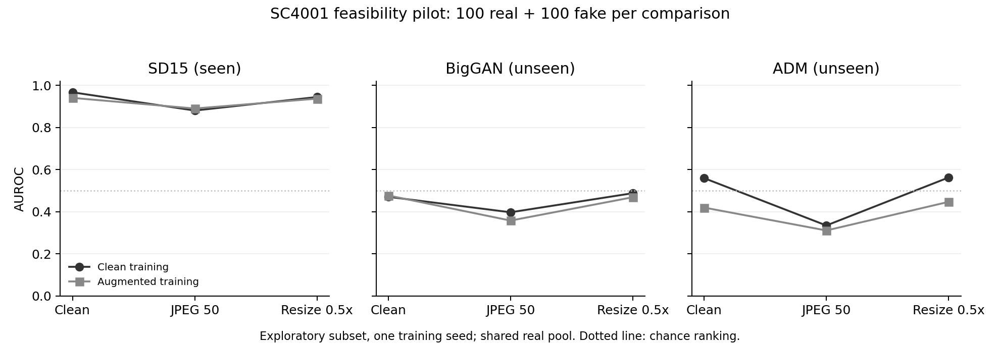

# SC4001 AI Image Detection

Run a small cross-generator experiment before committing to project direction J.
This repository contains the local feasibility pilot, its data manifest, and measured results.

For group discussion, read the [two-page Chinese pilot report](output/pdf/sc4001_j_pilot_report_zh.pdf).
The [Chinese message draft](output/sc4001_j_group_message_zh.txt) provides a short introduction you can forward.

## Measured results

The RTX 4050 run completed feature extraction and evaluation in 64.4 seconds.
Feature extraction took 48.1 seconds; peak PyTorch GPU allocation was 239 MB.
This excludes data preparation, environment setup, and the earlier weight download.
The successful data-preparation run took 210.9 seconds, including reused downloads.

Clean-trained CLIP achieved these AUROC scores; random ranking scores 0.5.
Each cell compares 100 real images with 100 generated images.

| Generator | Clean | JPEG50 | Half-resolution |
|---|---:|---:|---:|
| SD1.5, seen during training | 0.9669 | 0.8803 | 0.9445 |
| BigGAN, unseen during training | 0.4709 | 0.3975 | 0.4881 |
| ADM, unseen during training | 0.5596 | 0.3349 | 0.5626 |

Augmented training raised SD1.5 JPEG50 AUROC to 0.8899.
It did not consistently improve unseen-generator results.
The full metric table includes both variants and diagnostic classifiers.



The pipeline is affordable on this laptop, but this baseline does not demonstrate cross-generator generalization.
Dataset bias also needs attention: original dimensions alone yield 0.9100 AUROC on SD1.5.
All selected real sources are JPEG; generated sources are PNG.
SD1.5 images are 512 pixels square; BigGAN images are 128; ADM images are 256.
Uniform model inputs do not erase their different processing histories.
These diagnostics identify confounds; they do not prove which cues CLIP used.

Before developing fusion, test a source-controlled protocol and an additional training generator.
Keep these exploratory generators separate from any future final evaluation.

## Run the pilot

Use Python 3.12 and an NVIDIA GPU with a compatible driver.
Run these commands in PowerShell from the repository root.
The first run downloads selected images and CLIP weights.

```powershell
py -3.12 -m venv .venv
./.venv/Scripts/python.exe -m pip install -r requirements.txt
./.venv/Scripts/python.exe -u scripts/prepare_data.py
./.venv/Scripts/python.exe -u scripts/run_pilot.py --batch-size 32
./.venv/Scripts/python.exe scripts/summarize_results.py
```

The original run reused installed PyTorch through `venv --system-site-packages`.
The commands above create a standalone environment.
Results go into `results/`; images, weights, features, and trained heads stay local.

## Experiment

The frozen OpenAI CLIP ViT-B/32 encoder provides image features.
A logistic regression head predicts real or generated images.
We compare clean training with clean, JPEG70, and half-resolution training views.
Both models use the same original training images.

| Partition | Real | SD1.5 | BigGAN | ADM |
|---|---:|---:|---:|---:|
| Training | 300 | 300 | 0 | 0 |
| Validation | 100 | 100 | 0 | 0 |
| Exploratory development | 100 | 100 | 100 | 100 |

Each development comparison uses 100 real and 100 generated images.
The three comparisons share the same real pool.
We check clean images, JPEG50 compression, and half-resolution resizing.
All images receive the same RGB conversion and 224-pixel square crop before those transformations.

The validation set selects each model's decision threshold once.
Development labels never select thresholds or hyperparameters.
AUROC measures ranking; balanced accuracy uses that fixed threshold.
Average precision and the real-image false-positive rate supplement those metrics.

## Data and checks

Images come from [TheKernel01/Tiny-GenImage](https://huggingface.co/datasets/TheKernel01/Tiny-GenImage).
Its card attributes the collection to [yangsangtai/tiny-genimage](https://www.kaggle.com/datasets/yangsangtai/tiny-genimage).
This is a third-party subset of [GenImage](https://github.com/GenImage-Dataset/GenImage), with inherited generator labels.
The Hugging Face card declares CC BY-NC-SA 4.0; underlying image rights still apply.
Raw images are excluded from Git.

The script pins the dataset revision and verifies four source shards by SHA-256.
It samples those shards with seed `20261018`.
The four shards total approximately 1.90 GB; model weights add 605 MB.
It removes matching decoded pixels and matching normalized crops before splitting.
It also rejects difference hashes within three bits of an earlier image.
This heuristic catches some near-duplicates; it cannot establish semantic independence.

Two diagnostic classifiers use image-quality proxies or original dimensions alone.
Strong diagnostic performance indicates possible dataset shortcuts.
The CLIP classifier never receives source paths, dimensions, or generator labels as inputs.

## Outputs

| File | Contents |
|---|---|
| `results/manifest.jsonl` | Selected source rows, partitions, labels, and image hashes |
| `results/data_preparation.json` | Sampling counts, deduplication counts, and preparation time |
| `results/metrics.csv` | Scores for each model, generator, and transformation |
| `results/predictions.csv` | Per-image development predictions |
| `results/run_metadata.json` | Hardware, revisions, timings, settings, and limitations |
| `results/verification.json` | Independent metric checks and source-format audit |
| `results/pilot_auroc.png` | AUROC chart for both CLIP training variants |
| `results/environment.json` | Package versions used for the measured run |
| `artifacts/linear_heads.joblib` | Locally saved classifiers |

The feature cache checks the manifest and preprocessing identity before reuse.
The pipeline checks downloaded file hashes before training.
Only load saved classifier files you trust.

## Interpretation limits

These are exploratory development results from one small subset and one training seed.
They do not establish performance on future generators or authenticate the dataset labels.
CLIP pretraining overlap is unknown.
Per-cell bootstrap intervals describe sampling uncertainty within this subset.
Shared real images make comparisons statistically dependent.

This pilot follows the frozen-feature approach of [UnivFD](https://github.com/WisconsinAIVision/UniversalFakeDetect).
It uses ViT-B/32 and its own protocol, so it does not reproduce the paper's ViT-L/14 results.
The quality-aware fusion idea remains untested.

Codex prepared the scripts, documentation, and result summaries with the user's authorization.
