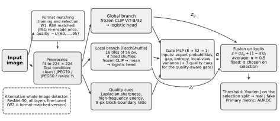
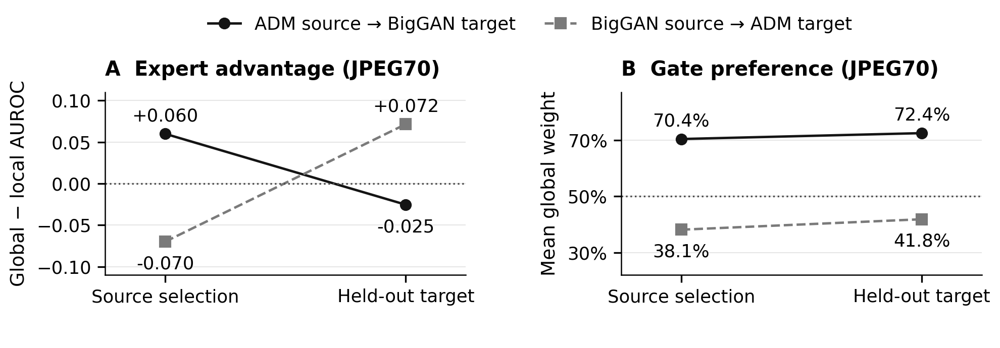

# Detecting AI-generated images

SC4001 group project: image detection across generators, JPEG compression and resizing.

We combine global image features with local patch features from frozen CLIP encoders.
The experiments compare simple averaging with a learned gate that uses image-quality cues to choose between the two branches.

<p align="center">
  <a href="reports/final_20261114/SC4001_Report_Final_20261114.pdf">Read the report</a> ·
  <a href="#results">Explore the results</a> ·
  <a href="#get-started">Get started</a> ·
  <a href="https://github.com/MagicianFrieren/SC4001-AI-Image-Detection/releases/tag/final-20261114">Download the submission</a>
</p>

<p align="center">
  
</p>

## Results

Format matching improves ranking under JPEG compression, with lower scores on clean and resized images.
Simple averaging scores above the quality-aware gate in all four conditions below.

| Condition | Original average | Original gate | Matched average | Matched gate |
| :--- | ---: | ---: | ---: | ---: |
| Clean | **0.8711** | 0.8622 | 0.8268 | 0.8117 |
| JPEG70 | 0.7556 | 0.7460 | **0.7749** | 0.7663 |
| JPEG50 | 0.7622 | 0.7511 | **0.7768** | 0.7619 |
| Resize ½ | **0.7866** | 0.7750 | 0.7747 | 0.7616 |

Values are AUROC, averaged over three data seeds and four generators: GLIDE, Midjourney, VQDM and Wukong.
Higher is better; 0.5 is chance ranking.
The table compares the Round 8 A original and format-matched arms on the Round 8 test images.
These images are new, while the generator domains had been inspected in earlier experiments.

[Per-seed results](results/round8_final/main_macro_each_seed.csv) · [Full report](reports/final_20261114/SC4001_Report_Final_20261114.pdf)

## Get started

Use Python 3.12. From the repository root, create an environment and rebuild the report tables:

```powershell
python -m venv .venv
.venv\Scripts\Activate.ps1
python -m pip install -r reports/final_20261114/requirements_analysis.txt
python scripts/report_evidence_20261111/build_evidence.py `
  --root output/analysis/report_evidence_20261111/sources `
  --output ../sc4001-table-rebuild
```

On Linux or macOS, activate with `source .venv/bin/activate` and use the single-line commands in the [reproduction guide](docs/FINAL_SUBMISSION.md).
The command reads the included result snapshots and writes eight CSV tables to the chosen output directory.
It needs no GPU or image downloads.

See the [reproduction guide](docs/FINAL_SUBMISSION.md) for figure rebuilding and the four analysis commands in the complete submission ZIP.

## What we tried

We tested seven changes: checkpoint selection, gate inputs, ranking objectives, condition routing, training-generator coverage, recompression cues and paired-view training.
The [comparison table](output/analysis/report_evidence_20261111/tables/improvement_comparisons.csv) gives each change's baseline and result.
Checkpoint selection recovered performance to approximately the averaging baseline; the gate still lacked a consistent advantage.

The development diagnostics trace part of the JPEG loss to a mismatch between the expert preferred on source-selection data and the expert that works better on another generator.
Feature interventions suggest that quality cues contribute to this mismatch.
Resizing shows a different pattern, including a positive gating result in the development analysis.

<details>
<summary>Expert preferences across generators</summary>



The diagnostics reuse the development image pools across seeds.
The loss decomposition describes the fitted models' behaviour; the report discusses its scope alongside the feature interventions.

[Analysis figures](output/analysis/report_evidence_20261111/figures/) · [Claim and evidence index](output/analysis/report_evidence_20261111/claim_evidence.csv)

</details>

## Project files

| Part | Where to look |
| --- | --- |
| Report | [PDF](reports/final_20261114/SC4001_Report_Final_20261114.pdf), [Word source](reports/final_20261114/SC4001_Report_Final_20261114.docx) and [figures](reports/final_20261114/) |
| Final evaluation | [Round 7](docs/ROUND7_FINAL.md), [Round 8](docs/ROUND8_FINAL.md) and [saved metrics](results/round8_final/) |
| Improvement studies | [Comparison tables and evidence](output/analysis/report_evidence_20261111/) |
| Analysis code | [Table, figure and bootstrap scripts](scripts/report_evidence_20261111/) |
| Experiment history | [Protocols and study notes](docs/README.md) |
| Complete submission | [Release ZIP and checksums](https://github.com/MagicianFrieren/SC4001-AI-Image-Detection/releases/tag/final-20261114) |

<details>
<summary>Data, methods and earlier experiments</summary>

The data are a pinned subset of [Tiny-GenImage](https://huggingface.co/datasets/TheKernel01/Tiny-GenImage), drawn from [GenImage](https://github.com/GenImage-Dataset/GenImage).
The dataset card declares CC BY-NC-SA 4.0; underlying image rights still apply.

The global branch follows the frozen-feature approach of [UniversalFakeDetect](https://github.com/WisconsinAIVision/UniversalFakeDetect).
The local branch uses four PatchShuffle views inspired by [SFLD](https://arxiv.org/abs/2502.17105).
Both use CLIP ViT-B/32 features with logistic regression heads.

The [experiment notes](docs/README.md) link the earlier rounds and the November source directories.
Full training requires the indexed images, weights and feature caches described in the [reproduction guide](docs/FINAL_SUBMISSION.md).
Contributions and AI use are recorded in the final report.

</details>
