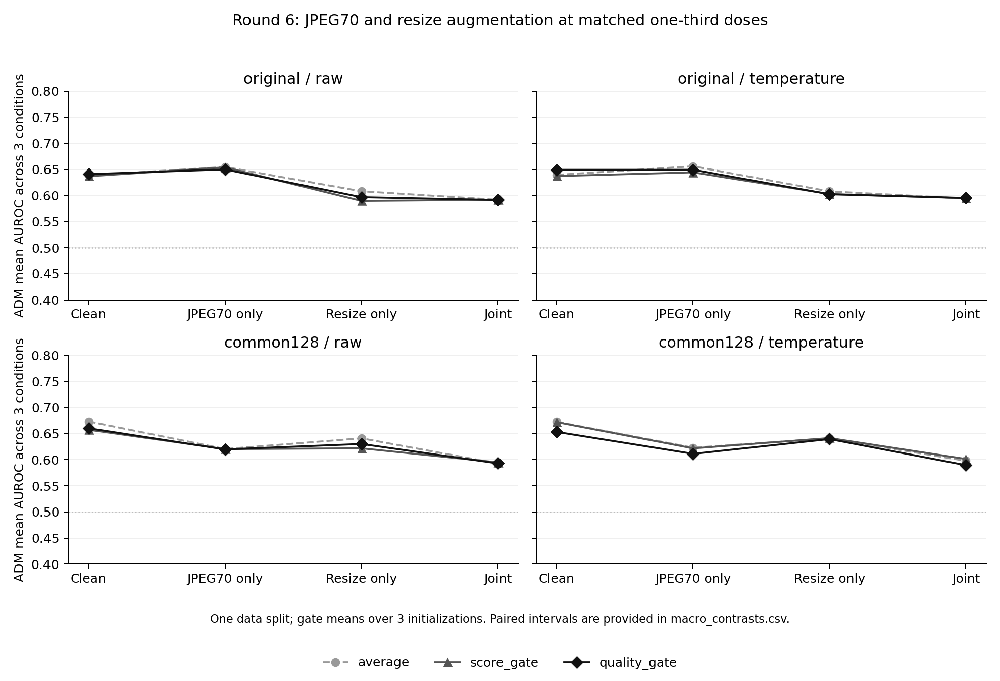

# SC4001 AI Image Detection

Explore whether global and local image features can improve AI-generated image detection across generators and image degradations.
This repository contains our frozen-CLIP baseline, fusion experiments, and measured results through **Round 6**.

**Current finding:** quality-aware gating has not consistently beaten simple average fusion.
JPEG and resize augmentation effects depend on preprocessing; combined augmentation lowered ADM performance in our latest comparison.
These are small exploratory experiments, not a finished detector or a blind benchmark.

## Start here

You can review the results on GitHub without downloading images or installing Python.

1. Read the [experiment guide](docs/EXPERIMENTS.md) for the questions, controls, and code behind each round.
2. Read the [latest interpretation in Chinese](results/round6/interpretation_zh.txt) and [full summary](results/round6/summary_zh.txt).
3. Inspect the [macro results](results/round6/macro_summary.csv), [paired comparisons](results/round6/macro_contrasts.csv), and [verification record](results/round6/verification.json).
4. Follow the [reproduction guide](docs/REPRODUCING.md) to check saved results or rerun the experiments.

The [initial English report](output/pdf/sc4001_j_preliminary_report_en.pdf) covers the pilot only.
For current progress, use the links above.

## Latest results

Round 6 separates JPEG70 and half-resolution augmentation during expert training.
Both augmentation types have weight 1/3 whenever present; each original image keeps total weight 1.
The gate training, calibration, selection, and development data stay fixed across these comparisons.

The table reports average fusion without calibration on ADM, a generator excluded from fitting.
Each value averages AUROC over clean, JPEG50, and half-resolution development conditions.
AUROC measures ranking: 0.5 is random ranking, and higher is better.

| Expert training | Original preprocessing | Common 128 preprocessing |
| --- | ---: | ---: |
| Clean only | 0.6387 | 0.6731 |
| Clean + JPEG70 | 0.6546 | 0.6205 |
| Clean + half-resolution | 0.6082 | 0.6410 |
| Clean + JPEG70 + half-resolution | 0.5918 | 0.5929 |

Original preprocessing fits the image to 224 pixels square.
Common 128 first fits to 128 pixels square, then resizes to 224 pixels square.
Half-resolution degradation resizes 224 → 112 → 224 after preprocessing.

Adding resize augmentation to the JPEG-only arm lowered original-preprocessing AUROC by 0.0628; the paired 95% interval was [-0.1003, -0.0254].
The JPEG-only gain over clean training remains uncertain: +0.0159, with interval [-0.0149, +0.0480].
Under common 128 preprocessing, both single augmentations lowered ADM AUROC.



Quality-aware gating still lacks a consistent advantage.
With original preprocessing and JPEG-only training, average fusion scored 0.6546, ordinary gating 0.6540, and quality-aware gating 0.6501 without calibration.
Gate scores average three initializations on the same data split.
See the [Round 6 protocol](results/round6/protocol.json) for the complete comparison.

## Code to read first

| File | Purpose |
| --- | --- |
| [run_pilot.py](scripts/run_pilot.py) | Frozen CLIP features, logistic regression, degradation transforms, and baseline evaluation |
| [local_branch.py](scripts/local_branch.py) | Four deterministic PatchShuffle views for the local expert |
| [gate_models.py](scripts/gate_models.py) | Matched ordinary and quality-aware gates |
| [score_calibration.py](scripts/score_calibration.py) | Per-expert temperature calibration |
| [run_round6.py](scripts/run_round6.py) | Latest matched-dose augmentation experiment |
| [verify_round6.py](scripts/verify_round6.py) | Full artifact checks, expert refits, and paired uncertainty estimates |

Both experts use frozen OpenAI CLIP ViT-B/32 features and separate logistic regression heads.
The global expert receives the processed image.
The local expert averages four feature vectors from shuffled 56-pixel tiles.

Fusion combines expert logits as `alpha * global_logit + (1 - alpha) * local_logit`.
Average fusion sets `alpha = 0.5`; fixed fusion selects one weight on validation data.
The learned gates predict a weight for each image.
Quality-aware gating adds sharpness, frequency, and block-boundary proxies to the ordinary gate inputs.
The [experiment guide](docs/EXPERIMENTS.md) explains the shared inputs and data partitions.

## Run a saved-result check

The lightweight check needs Python 3.12, NumPy, SciPy, and scikit-learn.
It reads committed results without images, model weights, a GPU, or retraining.
Run these commands in PowerShell:

```powershell
git clone https://github.com/MagicianFrieren/SC4001-AI-Image-Detection.git
cd SC4001-AI-Image-Detection
py -3.12 -m venv .venv
./.venv/Scripts/python.exe -m pip install numpy==1.26.4 scipy==1.17.1 scikit-learn==1.8.0
./.venv/Scripts/python.exe scripts/verify_shared_results.py
```

Expected output includes `"status": "passed"` and `"round6_metric_cells": 1440`.
This checks source/protocol hashes and recomputes Round 6 point metrics from predictions.
It does not repeat model fitting or validate bootstrap intervals.
For those checks, follow the [full reproduction steps](docs/REPRODUCING.md).

## Data and result files

We use a pinned subset of [Tiny-GenImage](https://huggingface.co/datasets/TheKernel01/Tiny-GenImage), a third-party subset of [GenImage](https://github.com/GenImage-Dataset/GenImage).
The manifests record source rows, original-image partitions, and image hashes.
The pilot contains 1,200 images; Round 2 adds 400 BigGAN images while preserving all pilot assignments.
Later experiments use subsets of this 1,600-image pool.

Each `results/roundN/` folder contains its protocol, predictions, metrics, verification record, and interpretation.
Rounds 4–6 also include gate parameters and training curves.
Raw images, downloaded weights, feature caches, and fitted joblib experts stay outside Git.
Use [restore_data.py](scripts/restore_data.py) to recover the manifest images before a full rerun.

## Interpretation limits

- ADM has been inspected repeatedly during development. It is excluded from fitting, but it is not a blind final test.
- BigGAN becomes a training generator in the mixed-data experiments. Its gains do not establish unseen-generator generalization.
- Real sources are JPEG and generated sources are PNG, with different native sizes. Common preprocessing does not erase source history or content confounding.
- Three gate initializations share one data split. They do not replace repeated training splits or new generator sources.
- Bootstrap intervals condition on fitted models, share real images across comparisons, and have no multiple-comparison correction.
- Augmentation changes both the expert's feature standardization and fitted classifier. These results do not isolate a pixel-level failure mechanism.

We retain clean training as the reference and original-preprocessing JPEG-only training as a candidate for further checks.
Next priorities are repeated training partitions and genuinely new generator sources.
Adaptive fusion remains a hypothesis to test.

## References and attribution

- [UniversalFakeDetect / UnivFD](https://github.com/WisconsinAIVision/UniversalFakeDetect): frozen-feature detection reference. Our ViT-B/32 experiments do not reproduce its ViT-L/14 results.
- [SFLD](https://arxiv.org/abs/2502.17105): PatchShuffle reference. Our four-view, 56-pixel implementation is inspired by the method, not a reproduction.
- [GenImage](https://github.com/GenImage-Dataset/GenImage): benchmark context and baseline implementations.

The Tiny-GenImage card declares CC BY-NC-SA 4.0; underlying image rights still apply.
Its generator labels are inherited and have not been independently authenticated.
Codex assisted with scripts, documentation, and result analysis under the project owner's direction.
